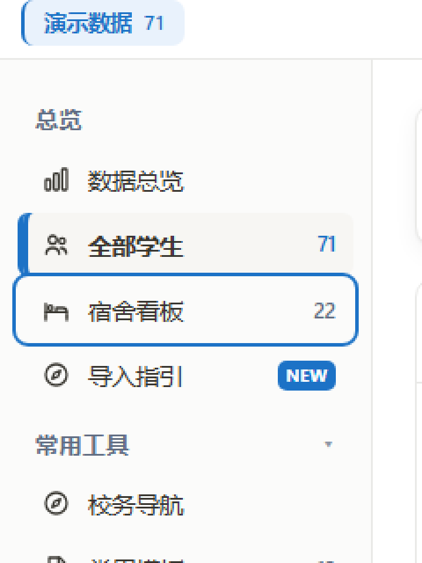
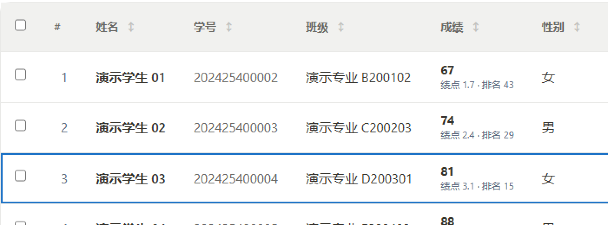

# 第 2 轮整改：键盘可达 + 对话框与提示语义

- **整改对象**：`中南大学生工作台.html`（真·源文件）→ 构建产物 `app/src/index.html`（随包发布的就是它）
- **对应评审条目**：`docs/design/UI评审-2026-10-17.md` 的 **P0-①（div+onclick 键盘到不了）** 与 **P0-④（撤销条/confirm/toast 缺语义）**
- **日期**：2026-10-17
- **状态**：已实施，已进源文件（原型 2,550,175 字节；构建产物 2,553,328 字节）

一句话结论：**页面里 124 个「只靠鼠标能点」的元素现在都能 Tab 到、Enter/空格能激活；确认框与弹窗有了 `role`、焦点陷阱、Esc 与焦点归还；撤销条与 toast 有了 `aria-live`。视觉零改动（逐像素比对见第 ⑤ 节）。**

---

## ⓿ 本轮改了什么

改动分三处，**没有动任何一条已有的业务渲染函数**。

| # | 位置（构建产物 `app/src/index.html` 行号） | 改动 | 为什么 |
|---|---|---|---|
| 1 | `2745` `#undoBar` / `2750` `#toast` | `#undoMsg`、`#toast` 补 `role="status" aria-live="polite"`；`#undoBar` 补 `role="region" aria-label`；`.undo-close` 补 `aria-label` | 撤销条与提示出现时，读屏用户此前完全不知道发生了什么 |
| 2 | 追加进 `<style id="round1-a11y">`（`2615` 起，本轮新增段 `2670`–`2688`） | `tr[data-kbd="1"]:focus-visible{outline:none;box-shadow:inset 0 0 0 2px var(--accent)}` 等 5 条 | 表格行/单元格的 `outline` 在 Chromium 上不可靠，会被相邻单元格盖住 |
| 3 | `12737` 起新增 `<script id="round2-a11y">`（挂在 `</body>` 前） | 运行时给 `div+onclick` 补 `tabindex/role/aria-label`、Enter/空格激活、对话框焦点管理 | 见第 ① 节 |

### 影响面（运行时统计，`window.__a11yScan()`）

| 指标 | 数值 | 说明 |
|---|---|---|
| 全页 `onclick` 属性 | 299 | 静态统计 |
| 被升级为键盘可用的元素 | **124** | 运行时打上 `data-kbd="1"` |
| 其中 `role="button"` | 44 | 真正的「假按钮」（侧栏项、统计卡、自定义下拉…） |
| 其中只加 `tabindex`、保留隐式 role | 80 | `tr/td/th`（见第 ② 节第 3 条） |
| 有意跳过 | 175 | 原生控件、遮罩/弹窗容器的 `stopPropagation` 包装、`tabindex="-1"`、已停用态 |
| 有 `aria-current="page"` 的导航项 | 1 | 跟随 `.side-item.active` |
| 漏网元素 | **0** | `__a11yScan().unhandledCount` |

---

## ① 为什么用「运行时升级」，而不改 116 处模板

页面里 `div/span/tr/th/td` 配 `onclick` 的模板分布在十来个渲染函数里（`renderList`、侧栏渲染、`openDetail`（`9396`）、`setSort` 表头（`7420`）、`awardSortBy`（`11108` / `12060`）…）。逐处改成 `<button>` 需要同时重写这些函数的 CSS 选择器（`.side-item`、`tr`、`td` 的现有样式全按标签/类名写），回归面远大于收益，而且在单文件 1.29 万行的规模下没法靠测试兜住。

所以采用**运行时升级 + `MutationObserver`**：

- 页面启动后扫一遍（`tagAll(document.body)`），之后 DOM 每次变化（换模块、翻页、筛选重绘）由 observer 增量补；
- 已有行为完全不动：升级只加 `tabindex`/`role`/`aria-label`/`data-kbd` 四个属性，不改 `onclick`、不改 DOM 结构；
- 幂等：`if(window.__a11yRound2) return;`，重复注入不会重复绑定；
- 调试钩子：`window.__a11yScan()` 返回 `{onclickTotal, upgraded, roleButton, tabindex0, unhandled}`，用来在真实浏览器里自检漏网（本轮 `unhandledCount: 0`）。

**代价**：这套升级只认「页面里已有的 `onclick` 属性」。将来有人用 `addEventListener` 绑定可点元素，升级脚本看不到——所以规范第 14 条写死了「新模板必须直接输出正确语义」。

---

## ② 升级规则（可对照代码）

### 1. 哪些会被跳过（其余全部补上键盘语义）

| 跳过条件 | 例子 | 理由 |
|---|---|---|
| 原生控件 | `BUTTON/A/INPUT/SELECT/TEXTAREA/SUMMARY` | 本来就可用键盘 |
| 无 `onclick` | 纯布局 `div` | 不是可交互元素 |
| `onclick` 只是 `event.stopPropagation()` | `div.mask`（22 处）、`div.modal`（22 处） | 这是「点自己别关窗」的包装，升级成按钮反而会被读屏逐个念 |
| class 含 `mask` / `side-mask` | 遮罩层 | 同上 |
| 含 `disabled` 类 / `tabindex="-1"` | 停用态元素 | 作者明确表达「不可交互」 |
| 带 `data-kbd-skip` | 预留逃生口 | 需要人工豁免时用 |

### 2. 可访问名怎么来

`labelFor(el)`：`title` → 可见文字（超 80 字截断）→ 纯符号兜底。

- 纯符号判断 `SYMBOL_ONLY = /^[\s×✕✖✗✘+\-–—·.。→←↑↓＋]+$/`；
- `.modal-close` 的兜底是「关闭」，其它纯符号兜底是「操作」；
- **有文字的按钮不会被兜底名覆盖**，避免把「导出 CSV」念成「操作」。

### 3. 表格行/单元格：只加 `tabindex`，不抢 `role`

`tr/td/th` 保留隐式 role（`row`/`cell`/`columnheader`），只补 `tabindex="0"`。
这样读屏还能说出「第 3 行、第 2 列，学号 202425400002」；改成 `role="button"` 就把位置信息弄丢了。

配套 CSS 必须换写法（产物 `2678`–`2688`）：

```css
tr[data-kbd="1"]:focus-visible:not(#dsh-a11y-guard){
  outline:none !important;
  box-shadow:inset 0 0 0 2px var(--accent) !important;
}
html[data-theme="dark"] tr[data-kbd="1"]:focus-visible:not(#dsh-a11y-guard){
  box-shadow:inset 0 0 0 2px #6cb0f2 !important;
}
th[data-kbd="1"]:focus-visible, td[data-kbd="1"]:focus-visible{ outline-offset:-3px !important; }
[data-kbd="1"]{ cursor:pointer; }
```

两个坑：

1. **`inset` 而不是外扩**：表格行贴着容器边框，外扩的环会被 `overflow:hidden` 裁掉。
2. **`:not(#dsh-a11y-guard)` 这个假 id 不能省**：第一轮那条全局焦点环是
   `:focus-visible:not(#dsh-a11y-guard)`，特异性 (1,1,0)。如果这里只写 `tr[data-kbd="1"]:focus-visible`（(0,2,1)），
   全局那条会反过来压过本条的 `outline:none`，于是 `<tr>` 上**同时**出现外描边和内阴影（实测踩过一次）。
   加上假 id 把特异性抬到 (1,2,1) 才稳。

### 4. 键盘激活

document 上的 keydown 委托：

- `Enter` → `el.click()`；
- `空格` → 先 `preventDefault()`（否则页面会滚），再 `el.click()`；
- `e.repeat` 直接忽略，防按住连发。

**为什么合成 `click()` 是安全的**：行/表头的 `onclick` 都是字面量参数，不读 `event.target`
（`7420: setSort(${jsq(c.key)})`、`8727: <tr onclick="openDetail(${jsq(String(s['学号']))})">`、`12060: awardSortBy('${k}')`），
所以合成事件的 target 指向哪里，行为都和鼠标点一致。

### 5. 切模块会重绘，焦点不能被吞

切模块会整块重绘 `#mainArea`（有的路径连侧栏一起重绘）。激活后 40ms 检查一次：
如果「焦点掉回了 `body`」且「原元素已脱离文档」，就把焦点移到新的
`.side-item.active[data-kbd="1"]`，键盘用户不会一步丢到页面开头。

### 6. `aria-current`

`.side-item.active` 补 `aria-current="page"`，只标**当前模块**；行的选中态走各自已有的语义，
不在这里重复标记。

---

## ③ 对话框：role、焦点陷阱、Esc、焦点归还

对 `#confirmRoot` 与 `#modalRoot` 统一做 `syncRoot()`（容器每次变化都跑）：

| 属性 | 取值 | 说明 |
|---|---|---|
| `role` | `confirmRoot` → `alertdialog`；其它 → `dialog` | 已有 `role` 不覆盖 |
| `aria-modal` | `true` | 遮罩打开时背景不可交互 |
| `aria-labelledby` | 指向 `.modal-title`（自动补 `id`） | 标题是弹窗的唯一名称 |
| `aria-describedby` | 指向 `.modal-body` | 正文（含影响人数、不可撤销提示）会被先读出来 |

### 初始焦点优先级（这里踩过坑）

1. 作者显式标的 `[autofocus]`；
2. 确认框的 `.modal-foot .btn`（即**「取消」**）——破坏性操作的默认动作必须是「不做」；
3. 其它弹窗的 `.modal-foot button`（主操作）；
4. 第一个非 `.modal-close` 的可聚焦元素。

**不能直接落在 × 上**：焦点停在「关闭」时，顺手一个回车就把刚打开的窗口关了。
首版实现正是落在 × 上，探针跑出 `dialogFocusText: "×"` 才发现，已改为上面的顺序。

**不抢焦点的情况**：作者/引导流程已经把焦点放进弹窗时（新手引导会 focus「跳过」），
`modal.contains(document.activeElement)` 为真就不做处理，避免打断引导。

### 其余行为

- **Tab 环绕**：`focusables(modal)` = 标准可聚焦选择器 + `offsetParent !== null` 过滤；末位 Tab → 首位，首位 Shift+Tab → 末位；焦点跑出弹窗则拉回首位。
- **Esc 关闭**：捕获阶段处理，`confirmRoot` → `closeConfirm()`，`modalRoot` → `closeModal()`。
- **焦点归还**：打开时记录 `document.activeElement`，关闭后还给它。

---

## ④ 提示：`aria-live` 挂在哪很重要

```html
<div class="undo-bar" id="undoBar" role="region" aria-label="撤销提示">
  <span id="undoMsg" role="status" aria-live="polite">已删除 3 名学生</span>
  <button class="btn">撤销</button>
  <span class="undo-close" role="button" aria-label="关闭撤销提示">×</span>
</div>
```

`aria-live` 挂在 **`#undoMsg` / `#toast` 文字节点自己身上**，不是外层容器。
挂在外层容器上的后果：每次内容更新（包括「撤销」按钮的出现）都会把容器整段重读一遍，
读屏用户听到「已删除 3 名学生 撤销 撤销 撤销」。`.toast` 额外 `aria-atomic="true"`，
因为 toast 的内容是整体替换而不是追加。

---

## ⑤ 实测结果（可复跑，跑的是构建产物）

### 探针：headless Edge 里真的按键盘

```powershell
node .verify\build-probe.mjs      # 生成 .verify\probe.html
msedge --headless=new --disable-gpu --no-first-run `
  --user-data-dir=.verify\prof --virtual-time-budget=12000 --dump-dom `
  file:///D:/Develop/辅导员工作台/.verify/probe.html > .verify\probe-dom.html
# 从 dump 里取 <div id="probe-out"> 的 JSON
```

本轮结果（全绿）：

| 检查 | 结果 |
|---|---|
| 升级元素数 | 124（`unhandledCount: 0`） |
| 动态插入的 `div+onclick` | 升级后 `tabindex=0/role=button`，Enter 与空格各激活一次 |
| **键盘切模块**（端到端） | 焦点在「宿舍看板」按 Enter → 主区内容变化、`.side-item.active` 从「全部学生」变「宿舍看板」、`aria-current` 跟随、焦点未掉回 `body` |
| 确认框语义 | `role=alertdialog`、`aria-modal=true`、`labelledby/describedby` 均在、初始焦点=「取消」 |
| Tab 环绕 | 首尾各测一次，均 `true` |
| Esc 关闭 + 焦点归还 | 关闭成功，焦点回到打开它的 `div#kbd-probe` |
| 普通弹窗 | `role=dialog`、初始焦点=「好」、× 升为 `aria-label="关闭"` |
| toast | `role=status`、`aria-live=polite`、写入后 `show` |
| 撤销条 | `#undoMsg` `aria-live=polite`、`.undo-close` = `1/button/关闭撤销提示` |

### 视觉回归：0 差异

第 1 轮状态 vs 第 2 轮状态各截一张 1440×900，逐像素比对：

```
diffPixels: 2066 / 1,296,000（0.16%）
bbox: x 463–727, y 19–31   ← 顶栏「金句」轮播那一行
```

再对**同一个文件连拍两次**：差异 2205 px、bbox 同样落在 y 19–31。
所以那 0.16% 是轮播金句的非确定性内容，**不是本轮改动造成的**——本轮零视觉回归。

### 焦点环证据

侧栏项的焦点环（`div.side-item`，非原生控件，3 倍放大）：



表格行的焦点环（`tr[data-kbd="1"]`，内阴影，2 倍放大——注意描边在行内侧，没有被表格容器裁掉）：



---

## ⑥ 顺带修正：改的到底是哪份文件

本轮之前的所有改动都落在 `app/src/index.html`。**这是错的**：该文件是构建产物，

```
中南大学生工作台.html  --(.build/sync/build-desktop.js)-->  app/src/index.html
                       注入桌面适配层（导出落地 / 外链走系统浏览器 / 关右键菜单）
```

手改产物会在下一次 `npm run build`（或 `npm run sync`）时整份被覆盖。

所以本轮**把两轮改动全部搬回原型 `中南大学生工作台.html`**，再重新构建：

- 备份：`.backup\prototype-orig-20261017.html`（原型原始）、`.backup\index-orig-20261017.html`（第一轮前的产物）、`.backup\index-round1-20261017.html`（第一轮产物）、`.backup\artifact-round2-20261017.html`（手动改的产物，仅留档）。
- 搬迁方式：用 `git diff --no-index` 生成「原产物 vs 改后产物」的补丁，逐 hunk 在原型里精确查找替换（每个 hunk 必须恰好命中一次，否则中止），最后一块（新增 `round2-a11y` 脚本）因为上下文含 shim 改为插到最后一个 `</body>` 之前。
- 构建后核对：产物与手工改的版本相比，差异**只有**桌面适配层与 a11y 脚本的先后顺序（62 行对 62 行），即本轮改动 1:1 搬到位。
- **注入顺序说明**：构建脚本把 shim 注入在最后一个 `</body>` 之前，而 a11y 脚本也在原型里 `</body>` 之前，所以产物里顺序是「a11y 脚本 → shim」。两者互不依赖（a11y 走 `DOMContentLoaded`），等价。

**以后改样式/交互，一律改 `中南大学生工作台.html`，然后 `cd app && npm run sync`。**

---

## ⑦ 本次明确没做的事（留给第 3 轮）

1. **P1 全部未动**：hover-only 才能发现的可点提示、触控目标 < 44px、卡片化后藏起排序与全选、多级排序不能逐级取消、图表无文本等价物、顶栏 `⋯` 10 项扁平菜单、筛选重绘丢焦点。
2. **暗色 `--accent` 一令牌两用**：链接文字 3.50:1 与主按钮白字 3.19:1 冲突，待拆 `--accent`（文字）+ `--accent-solid`（实底）。本轮没动，因为会改全站主色。
3. **表格没有上「漫游 tabindex + 方向键」**：现在 71 行每行一个 Tab 停靠点，纯键盘用户穿过整张表要按 71 次。标准 `role="grid"` 做法是整表一个停靠点、用方向键移动。本轮先保证「能到」，第 3 轮再谈「到得快」——roving tabindex 要接管方向键，会和表格横向滚动、单元格内输入框抢键，风险明显更高。
4. **没接自动化无障碍扫描**（axe-core）：本轮用探针 + 逐像素比对替代；要进 CI 建议单独接。

---

## ⑧ 复现方式

```powershell
cd D:\Develop\辅导员工作台
node .build\sync\build-desktop.js          # 原型 → 产物
node .verify\spec-check.mjs                # 第一轮的两条保证（特异性 18/0、对比度 35 项）
node .verify\build-probe.mjs               # 生成键盘探针页
# 再用上面的 msedge 命令跑 .verify\probe.html，取 probe-out 的 JSON
```

`.verify\png-diff.mjs a.png b.png` 做逐像素比对，`.verify\png-crop.mjs in.png out.png x y w h [放大倍数]` 裁图放大看细节。
