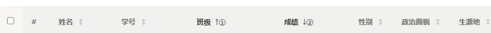
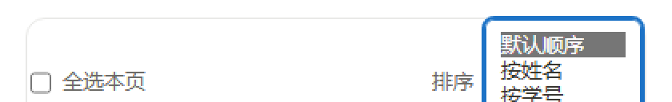
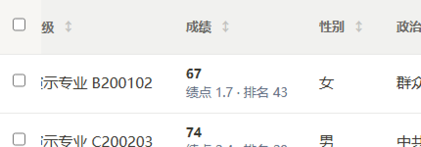

# 第 3 轮整改：设计系统收敛 + 三条结构性修复

> 时间：2026-10-17　对象：`中南大学生工作台.html`（原型，源文件）→ 重建 `app/src/index.html`（产物）
> 依据：`docs/design/UI评审-2026-10-17.md` 第 3 轮行（P2-1 / P1-4 / P1-5 / P2-9）
> 结论：**字阶 34 档 → 5 档、字重 17 种 → 2 种、圆角 26 档 → 3 档 + 令牌**；排序可逐级取消、窄屏卡片模式重新有全选与排序、筛选后焦点真的不掉了（原实现从未生效）；P2-9 经评估**不做**，理由见 ⑨。

---

## ⓿ 改动总表

| # | 评审项 | 改了什么 | 落在哪 | 用户能感知到什么 |
|---|---|---|---|---|
| 1 | **P2-1** | 字号、字重、圆角、字体栈全部令牌化 | 原型首个 `:root` + 全库声明 | 字大了一点、层级更清楚；不再有 9.5px / 620 字重这种零碎值 |
| 2 | **P2-1** | 新增 `--accent-solid`，与 `--accent` 分家 | `:root` / `:root.dark` / `html[data-theme="dark"]` | 暗色下主按钮白字达标（3.19 → 5.22） |
| 3 | **P1-5** | 排序从「一个带 ✕ 的标签」改成「每级一枚 chip」 | `sortChainHtml()` / `removeSortLevel()` / `.sort-chip` | 可以只撤掉第 2 级排序，保留第 1 级 |
| 4 | **P1-4** | 窄屏卡片模式补工具条（全选 + 排序下拉 + 升降序） | `cardToolBarHtml()` / `cardSort()` / `flipSortTop()` | 窗口拉到最小也有全选和排序了 |
| 5 | **P2-4** | 表格首列粘住（横向滚动时不跑掉） | `.tbl-wrap:not(.as-cards) th/td:first-child` | 字变大后表格更宽，横滚时勾选列仍在原地 |
| 6 | **P1-1** | 可点击提示由 hover-only 改为常显 | `.stat-click::after` / `.metric.clickable::after` / `.alert-go` / `.rm-del` | 触屏和键盘也能看见「这能点」 |
| 7 | **P1-2 / P2-5** | 命中区 44×44、输入类不低于 44px、无 hover 时提示常显 | `@media(hover:none)` 块 + 4 个图标按钮 `::before` | 手机上不再点不中 |
| 8 | **P1-8** | 修 `_patchMainArea`（此前从未生效）+ 焦点按路径还原 | `_patchMainArea` / `_snapshotPos` / `_restorePos` / `_focusSoon` | 筛选/重绘后焦点留在原处，不再掉回 body |
| 9 | — | 删掉 4 条永远不生效的 hover 位移 | `.stat` / `.nav-card` / `.theme-card` / `.op` | 无（本来就无效，只是别留着骗人） |
| 10 | **P2-9** | **不做**，只补文档说明覆盖链 | 见 ⑨ | 无 |

---

## ① 设计系统收敛（P2-1）

### 1.1 五档字阶

新增 5 个令牌（原型首个 `:root` 内）：

```css
--fs-xs: 13px;   /* 小字：标签、表头、辅助说明、角标 */
--fs-sm: 15px;   /* 正文字：表格内容、表单、侧栏、按钮 */
--fs-lg: 18px;   /* 小标题 / 卡片标题 */
--fs-xl: 24px;   /* 页面标题、统计大数字 */
--fs-ico: 32px;  /* 字形：空状态图标、大号头像字、emoji */
```

映射规则（脚本 `.verify/round3-css.mjs` 的 `mapFs()`）：`N < 14.2 → xs` / `< 15.9 → sm` / `< 20.9 → lg` / 其余 `→ xl`；下面这几个点是**按语义**单独提走的，不吃统一映射：

| 原值 | 令牌 | 说明 |
|---|---|---|
| `.drop-ico` 34px、`.empty-state .ico` | `--fs-ico` | 图标字形，不是文字 |
| `.avatar-big` 30px、`calibNum` 30px | `--fs-ico` | 圆形头像里的一个字、校准数字 |
| 内联 🎉44 / ✅40 / 🏅32 | `--fs-ico` | emoji 装饰 |

34 个数值档的去向：

| 令牌 | 原值 | 档数 |
|---|---|---|
| `--fs-xs` | 9.5 / 10 / 10.5 / 11 / 11.5 / 11.8 / 12 / 12.3 / 12.5 / 12.8 / 13 / 13.2 / 13.5 / 13.8 / 14 | 15 |
| `--fs-sm` | 14.5 / 15 / 15.5 | 3 |
| `--fs-lg` | 16 / 16.5 / 17 / 18 / 19 / 20 | 6 |
| `--fs-xl` | 21 / 22 / 24 / 25 / 26 | 5 |
| `--fs-ico` | 30 / 32 / 34 / 40 / 44（语义点：图标、头像字、emoji） | 5 |

**为什么是这 5 档，不是「把所有 px 换成最接近的那一档」**：取最接近会让 9.5 → 10、13.5 → 13.5 这种半像素档继续活着，档数压不下来；这一轮的口径是「宁可整体上移 1px，也要把档数砍到 5」。代价很明确：**正文从 12.5/13 统一到 13px，表格更宽了**，所以同轮补了「首列粘住」（见 ⑤）。

### 1.2 字重只留 400 / 600

改前 17 种：500 / 550 / 560 / 580 / 600 / 620 / 640 / 650 / 660 / 670 / 680 / 690 / 700 / 720（+ 3 个 `!important` 变体）。规则 `≤500 → 400`、`≥550 → 600`，保留 `!important`。
改后：`600` 182 处、`400` 40 处，**0 处其它取值**（`grep 'font-weight:\s*(?!400|600)'` 命中 0）。

顺带说明：中文只有 Regular / Medium / Bold 三档是可靠的，620～720 这种值在 Windows 上会被合成成同一档，本来就白写。

### 1.3 圆角收到三档

改前 26 档（20 个数值）：4 / 5 / 6 / 7 / 8 / 9 / 10 / 11 / 12 / 13 / 14 / 16 / 20 / 999 / 50% / `0 8px 8px 0` / 三类 `var()` 混用。
规则：`0 → 0`、`≤9px → 6px`、`≤20px → 12px`、`>20px → 6px`；`50%` 与既有 `var(--radius-*)` 保留；`0 8px 8px 0 → 0 var(--radius-btn) var(--radius-btn) 0`。
改后只剩：`0` / `6px` / `12px` / `50%` / `var(--radius-btn|card|cell)`。

⚠️ **一个有意为之的视觉变化**：4 处 `999px` 药丸（标签类）被归成 `6px`——设计系统里没有「药丸」这一档，要么加一档要么归到 6px，选了后者（与 `.tag` 一致）。截图里 `学习委员` 这类标签因此从全圆变成小圆角。

### 1.4 字体栈统一

改前 7 种，其中并存的 UI 栈有三个版本（含一个**永远加载不到**的 `Inter`），另有 2 个不同的等宽栈。
改后：

```css
--font-stack: system-ui, -apple-system, "Segoe UI", "PingFang SC", "Microsoft YaHei", sans-serif;
```

- `body` 与 notion 层（原为多行硬编码栈）改为 `var(--font-stack)`；
- 等宽统一为 `ui-monospace, "SF Mono", Consolas, monospace`（`.mono` 与 `.aw-col-key` 现已同串）；
- `inherit` 16 处保留（是「跟随父级」的语义，不是重复定义）；
- **例外**：`.xls` 导出模板里 `body{font-family:"Microsoft YaHei",…}` 保持独立——那是导出给 Excel 看的内嵌 HTML，不该被 App 主题影响。

删 `Inter` 的理由：项目没有打包字体文件，也没有 `@font-face`，写了也只会落到下一个回退项，留着让人误以为有 Inter。

### 1.5 度量（脚本实跑，不是估算）

| 维度 | 改前 | 改后 | 命令 |
|---|---|---|---|
| `font-size` 声明 | **34 个数值档**，裸 px | **0 个裸 px**，545 处声明全走 5 个令牌 | `node .verify\survey-css.mjs` → `[font-size] 0 档` |
| 实测渲染字号 | 30 档 | **4 档**：13px(739) / 15px(1136) / 18px(3) / 24px(4) | `node .verify\shot-pages.mjs a3` 打印分布 |
| `font-weight` | 17 种 | **2 种**（400 / 600） | `[font-weight] 2 档` |
| `border-radius` | 26 档（20 数值） | **13 种写法**（数值只剩 0 / 6 / 12 / 50%） | `[border-radius] 13 档（数值型 7）` |
| `font-family` | 7 种 | **5 种**（1 UI 栈 + 1 等宽栈 + inherit 语义 + xls 模板例外） | `[font-family] 5 种` |
| `style` 块 | 9 个 | 9 个（P2-9 未做） | 同上 |

评审给的验收线是「`font-size` 档数 30 → 5」，实测**渲染档数 30 → 4**、**声明档数 34 → 5 令牌（0 裸 px）**。

改前 / 改后像素差异（同一页面、1440×900、同一份演示数据）：

| 页面 | 差异像素 | 占比 | 说明 |
|---|---|---|---|
| 全部学生 | 157,030 | 12.12% | 字号整体变化，全表重排 |
| 宿舍看板 | 163,226 | 12.59% | 同上 |
| 奖学金评选 | 58,811 | 4.54% | 该页窄字用到得少 |
| 数据总览 | 159,379 | 12.30% | 统计数字 26 → 24 |
| 全部学生 @420 | 18,280 | 5.88% | 窄屏卡片的标签变宽（420×740 = 310,800 像素基准） |

后续三项功能改动（③④⑤⑥）全部落盘后，再跟「只做了设计系统收敛」的版本对比：**students 2368px / dorm 2546 / award 2158 / overview 11 / 420 518**（合计 < 0.2%）——说明排序链、卡片工具条、首列粘住、触控区这些改动**没有带来非预期的版面变化**。

---

## ② 暗色 `--accent` 一令牌两用 → 拆 `--accent-solid`

改前暗色 `--accent: #3b94e8` 同时被当「链接文字色」和「实心按钮底色」用，两个场景对同一个值的要求正好相反：

| 用途 | 需要的对比度 | `#3b94e8` 实测 | 结论 |
|---|---|---|---|
| 链接文字 on 卡片 `#373c3f` | ≥ 4.5 | 3.50 | ✗ |
| 白字 on 实心底 | ≥ 4.5 | 3.19 | ✗ |

改后拆成两个令牌，语义写进注释：

```css
/* 浅色 */
--accent-solid: var(--accent);         /* 文字/描边用 --accent，实心按钮底用 --accent-solid */
/* 暗色 */
--accent: #6cb0f2;      /* 文字：卡片上 4.85 */
--accent-solid: #1f6fb8; /* 实心底：白字 5.22 */
```

护眼主题不用特判：`--accent-solid: var(--accent)` 会自动跟着 `#3f6a4b`（白字 6.2:1）。
全库 7 处 `background: var(--accent)` 改为 `var(--accent-solid)`（`.aw-chip.on`、`.aw-bar i`、主按钮、`.st-seg button.on` 等），`.aw-chip.on` 那条 `border:1px solid var(--accent); color:#fff` 一并改掉。

`spec-check.mjs` 随之加了两条断言：`主按钮白字`（取 `--accent-solid`）与 `强调文字（链接）`（取 `--accent`）。脚本原先按「同一块里第一次出现的声明」取值，现在改为「最后一次出现的声明」（本轮在块尾追加覆盖），并对 `--accent-solid: var(--accent)` 解一层引用。

结果：**38 项对比度检查，0 失败**（此前那 1 项 `dark 主按钮白字 3.19` 已消）。实测 light 主按钮 4.92 / 链接 4.92、dark 主按钮 5.22 / 链接 4.85、eye 链接 5.30。

---

## ③ P1-5：排序可以逐级取消了

### 改前

`renderList()` 把整个排序状态压成一个按钮：`排序：班级升序 → 成绩降序 ✕`，`✕` 调 `clearSort()` —— 只撤第 2 级？没有这个入口，只能全清。

### 改后


- 每级一枚 chip：`箭头 + 列名 + ①/②/③ + ×`，点整枚 chip 就撤这一级；末尾「全部清除」。
- **级别用 ①②③ 而不是 1/2/3**：首版是数字，视觉上「班级 1」会被读成「1 个班级 / 数量」，改成圈码后没有歧义（`aria-label` 里仍是「第 1 级」）。
- 表头同步显示级别：`班级 ↑①`、`成绩 ↓②`（见下图；表头与 chip 用同一套圈码，裸数字会被读成数量）。
- 可访问名不把 `×` 混进去：`aria-label="成绩降序，第 2 级，点击取消这一级排序"`；箭头、圈码、`×` 全部 `aria-hidden="true"`，否则读屏会念成「成绩 降序 下箭头 二 叉」。
- 撤级后焦点落到 `#sortChain` 的第一枚 chip（`_focusSoon`），不会因为重绘掉回 body。
- 卡片头那个单按钮改成「取消排序」（只在有排序时出现），明确它是「清空全部」而不是「撤一级」。



`SORT_MAX = 3` 未改，超过 3 级时 `setSort` 仍按原规则挤掉最后一级。

> 既有回归测试 `.build/test/test-multisort.js` 里有两条断言写死了表头标记的裸数字（`↑1` / `↓2`），
> 行为口径改成圈码后同步改为 `↑①` / `↓②`——这是**口径变更**，不是为了让测试通过而放宽断言
> （旁边「排序链文案 = 班级↑ › 成绩↓」等断言未动）。

---

## ④ P1-4：窄屏卡片模式补上工具条

**为什么必须补**：`.tbl-wrap.as-cards thead{display:none}` 在 ≤760px 生效，而 760px 恰好等于 `tauri.conf.json` 的 `minWidth`——也就是说**把桌面窗口拉到最小，排序入口和全选就一起消失了**，这不是「手机上的小毛病」，是桌面端的可达性缺口。

改后，卡片模式在列表卡片内、表格之前渲染一条工具条：



- 左：「全选本页」勾选框（调 `toggleSelAll`，与表头复选框同一套逻辑）
- 右：「排序」下拉（`默认顺序` + 所有可排序列）+ 已有排序时的 `↓ 降序 / ↑ 升序` 按钮（`flipSortTop()` 切当前第 1 级的方向）
- 只在 `isNarrow()` 时渲染，宽屏不受影响

回归里在 420×740 下逐项验过：复选框存在且能全选 71/71、下拉选项为 `默认顺序 / 姓名 / 学号 / 班级 / 成绩 / 性别 / 政治面貌 / 生源地 / 联系电话 / 备注（保密）`、`cardSort('成绩')` → `成绩:desc`、`flipSortTop()` → `成绩:asc` 且按钮文案跟着变。

---

## ⑤ P2-4：首列粘住（由 ① 变宽引发的连带修复）

字号从 12.5 提到 13 之后，表格整体变宽，「辅导员备注」列被推到横向滚动区——这正是评审 P2-4 说的问题，本轮顺手修掉：

```css
.tbl-wrap:not(.as-cards) thead th:first-child{position:sticky;left:0;z-index:3;background:var(--hover)}
.tbl-wrap:not(.as-cards) tbody td:first-child{position:sticky;left:0;z-index:1;background:var(--panel)}
.tbl-wrap:not(.as-cards) tbody tr:hover td:first-child{background:var(--hover)}
```



- 必须给**不透明背景**，否则下面的列会透出来（`background:var(--panel)`；表头用 `var(--hover)` 与原有表头底色一致）；
- 全库没有 `nth-child(even)` 斑马纹，所以静态 `var(--panel)` 打底不会跟条纹打架；
- 实测：`th` 与 `td` 都是 `sticky / 0px`，横滚 331px 后勾选列仍在最左。

---

## ⑥ P1-1 / P1-2 / P2-5：常显化、44px 命中区、删掉假 hover

| 位置 | 改前 | 改后 |
|---|---|---|
| `.stat-click::after`、`.metric.clickable::after`（「查看」箭头） | `opacity:0`，只有 hover 出现 | `.38` 常显；`hover / focus-visible / focus-within` 升到 `1` |
| `.alert-go`（告警行箭头） | `0` | `.38`，`.alert-row.clickable:focus-within` 升到 `1` |
| `.remark-item .rm-del`（删除备注） | `0`，触屏根本看不见 | `.45`，`hover / focus-within / :focus-visible` 升到 `1` |
| `@media(hover:none)` 块 | 只有 2 条 | 扩成：侧栏项 `min-height:44px`、`.btab` 40px、输入类与按钮 `min-height:44px`、无 hover 时箭头/删除 `opacity:.75` |
| `.icon-btn / .quote-btn / .modal-close / .colrow-btn` | 28～30px 的点击区 | 加 `::before{width:44px;height:44px}` 把**命中区**扩到 44×44，视觉尺寸不变 |

**删掉 4 条永远不生效的 hover 位移**：`.stat:hover`、`.nav-card:hover`、`.theme-card:hover`、`.ops-grid .op:hover` 里的 `transform:translateY(-1px)`，以及 `.stat-click:hover`、`.metric.clickable:hover` 里的 `translateY(-2px)`。原因：规范第 06 章有一条 `[class]:hover{transform:none}`（第三轮补丁那次的右移 bug 也是它干的），这些位移从来没渲染出来过——留着只会让下一个人以为「hover 会浮起」，又踩一次同样的坑。

已知代价：4 个顶栏图标按钮的 44×44 命中区相差 1px 左右会重叠，实际影响可忽略（顶栏图标间距 >8px），若要彻底消除需要改成每个按钮 44px 宽的真实盒子。

---

## ⑦ P1-8：筛选后焦点丢失，根因不是那条守卫

评审的判断是「`_patchMainArea` 的守卫 `if(outer && snap && snap.top > 0)` 在未滚动时跳过」。查下去发现**更根本的两层问题**：

### 7.1 它从未生效

```js
const desc = Object.getOwnPropertyDescriptor(Object.getPrototypeOf(el), 'innerHTML');
if(!desc || !desc.set) return;   // ← 每次都从这里静默返回
```

`el` 是 `div`，`Object.getPrototypeOf(div)` 是 `HTMLDivElement.prototype`，而 `innerHTML` 的 setter 定义在 `Element.prototype` 上。实测：

```
ownOnProto:false   onElement:true   onHTMLElement:false
```

所以自 v2.3.0 起，「记位置 → 重绘后还原」这套机制**一次都没跑过**。平时看着正常，是因为浏览器在 `innerHTML` 重绘时会尽量保留滚动位置；但焦点确实会掉回 `body`。

**修法**：沿原型链向上找带 setter 的 descriptor，找到再安装，并给 `el` 打 `__keepPos` 防止重复包装。

### 7.2 就算装上了，下标还原在重绘瞬间会指偏

`_focusPath` 原来只记 `{tag, i}`（元素在 `querySelectorAll('input,select,textarea,button,[tabindex]')` 里的下标）。但新 DOM 还没被 round2 的语义升级补上 `tabindex`，那一刻集合长度是短的，`nodes[snap.focus.i]` 指到别的元素是常态。

**修法**：`_focusPath` additionally 记 `ph`（placeholder）与 `cls`（className），`_restorePos` 按 **name/id → `tag[placeholder="…"]` → `tag.class1.class2` → 下标** 的顺序解析，下标降级为最后兜底。

### 7.3 顺手补的两道保险

- `_snapshotPos()` 记 `view: S.view`，setter 里 `if(outer && snap && (!snap.view || snap.view === S.view))` —— **切模块不还原**，否则按比例还原滚动会把新页面拽到半截；
- 新增 `_pendingFocus` + `_focusSoon(sel)`（rAF + `setTimeout(…, 30)` 两次落焦），并把还原逻辑的焦点段改成 `if(snap.focus && !_pendingFocus)` —— 避免「还原焦点」和「有意的落焦」（撤级后、切排序方向后）互相打架。

---

## ⑧ 回归（全部可复跑）

| 检查 | 命令 | 结果 |
|---|---|---|
| 对比度 + 焦点环特异性 | `node .verify\spec-check.mjs` | `offenders:18 / worst:(0,4,1) / mine:(1,1,0) / losers:0`；`checks:38 / fails:0` |
| 排序链 + 卡片工具条 + 首列 + 焦点 | `node .verify\sortcheck.mjs` | **22/22** |
| 撤销条/提示条（第 3 轮补丁不回退） | `node .verify\hover-check.mjs` | **23/23** |
| 多级排序单元回归（既有测试） | `node .build\test\test-multisort.js 中南大学生工作台.html` | ✅ 全部通过 |
| 第 2 轮语义（键盘/对话框/aria-live） | `node .verify\build-probe.mjs` + Edge `--dump-dom` | `onclickTotal 300 / upgraded 124 / unhandled 0`，`confirmRole=alertdialog / focusText=取消 / tabWraps*=true / focusRestored=true / navSwitched=true / ariaCurrentOnActive=true` |
| 像素回归 | `node .verify\png-diff.mjs` | 见 ① 末表 |
| 构建 | `node .build\sync\build-desktop.js` | 原型 2,507.5 KB → 产物 2,510.6 KB |

---

## ⑨ 为什么这一轮**不做** P2-9（合并 style 块）

评审的 P2-9 是「把 7～9 个 `<style>` 块合并成一个」。评估后决定不做，理由按重要性排：

1. **回归面大、收益是零**：这些块是历史上逐层叠加的覆盖层（主样式 → notion-system → award-notion-fix → award-grouphead → lock-screen-style → award-workbench-v2 → round1-a11y → 匿名块）。合并只是搬运字面量，**用户看不到任何变化**，但任何一处顺序错位都会静默改变级联结果——本轮已经因为「特异性打平 + 顺序」踩过一次（撤销条右移）。
2. **`round1-a11y` / `round2` 层必须留在最后**：它们是 a11y 兜底（焦点环、`tr` inset 环、44px 命中区），语义上就要求「覆盖前面所有层」。合并进主样式会让这条契约消失，下一个人加规则时又要靠猜。
3. **真正的问题不是「块多」，是「不知道哪条规则生效」**：所以本轮做的是把这件事写进文档——`docs/design/视觉设计规范.md` 新增「新增规则该放哪一层」与覆盖链说明，`spec-check.mjs` 可以随时跑出「谁压谁」。

一句话：**P2-9 是纯重构，愿意做的时候应该配一次完整的视觉回归，而不是塞进这轮收尾**。

---

## ⑩ 遗留

1. **P2-3 / P2-6 / P2-7** 等仍未做（见评审文档第 3 轮行之后的剩余项）。
2. 暗色下 `--accent` 当链接色 4.85 只是刚好过线，若日后要提亮需同时复核 `--accent-solid`。
3. 4 个顶栏图标按钮的 44×44 命中区有约 1px 重叠（见 ⑥）。
4. `999px` 药丸归一为 6px 是**有意的**视觉变化，若产品上想要药丸态，应在规范里补第 4 档圆角而不是散着写。
5. 旧账：`app/src/.probe-write.txt` 是早前沙箱探测留下的空文件，删除会被策略拦，需要手动删。
